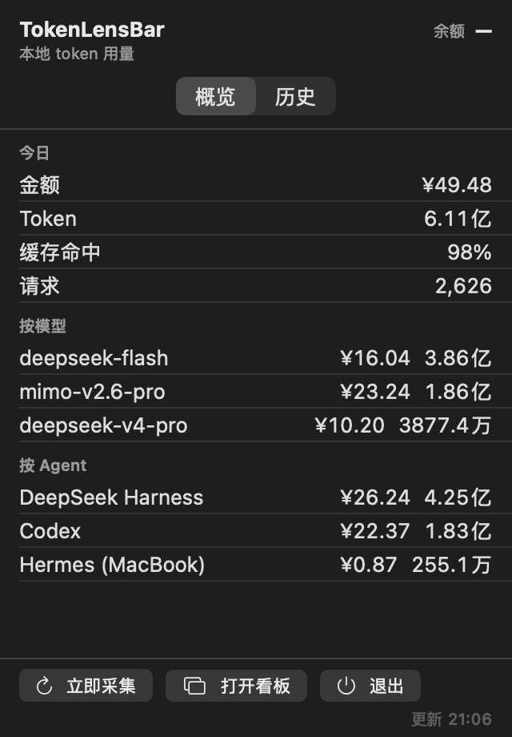
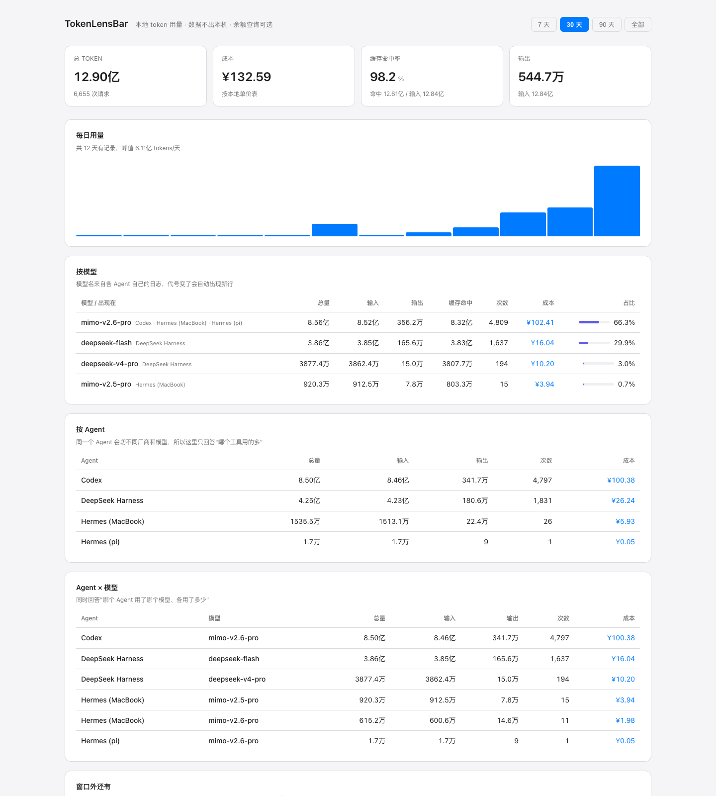

# TokenLensBar

纯本地、零网络的 token 用量监控（余额查询是可选功能）。采集器 ~900 行 Python（只用标准库）+ 原生菜单栏 App + 本地看板。

菜单栏点开是原生面板（概览 / 历史）：概览是今日 + 按模型/Agent，余额直接显示在标题右上角；历史看全部汇总。面板跟随菜单栏/系统浅色或深色。



（截图里关闭了余额，所以显示 `—`；填入 Key 后会显示真实余额。）

完整看板在浏览器里，顶部是每日用量柱状图：



```bash
./install.sh                       # 装好：采集库 + 单价表 + 定时任务 + 菜单栏 App
python3 tokenlensbar.py serve          # 浏览器看板 http://127.0.0.1:8787
```

## 装在哪

`./install.sh` 会把运行时从仓库复制出去，所以装完仓库可以挪走甚至删掉。

从旧版 `tokenlens` 升级：重跑 `./install.sh` 即可。它会把 `~/.tokenlens/` 迁到
`~/.tokenlensbar/`，并把旧的 `com.tokenlens.*` 任务换成 `com.tokenlensbar.*`。

| 东西 | 位置 |
| --- | --- |
| 菜单栏 App | `/Applications/TokenLensBar.app` |
| 采集器运行时 | `~/.tokenlensbar/tokenlensbar.py` |
| 看板页面 | `~/.tokenlensbar/web/index.html` |
| 数据 | `~/.tokenlensbar/usage.db` |
| 单价表 | `~/.tokenlensbar/prices.json` |
| 余额配置 | `~/.tokenlensbar/balances.json`（可选） |
| 余额 Key | `~/.tokenlensbar/secrets.json`（可选，权限 600） |
| 每 5 分钟采集 | `~/Library/LaunchAgents/com.tokenlensbar.scan.plist` |
| 登录自启 | `~/Library/LaunchAgents/com.tokenlensbar.bar.plist` |
| App 启动日志 | `~/.tokenlensbar/bar.log` |

## 启动 / 停止

菜单栏 App 是 `LSUIElement`（无 Dock 图标、不进 Cmd+Tab），装完即启动，
右上角状态栏显示今日 token 数，点一下展开明细。

```bash
open -a TokenLensBar            # 手动启动（没出现时用这个）
launchctl kickstart -k gui/$(id -u)/com.tokenlensbar.bar   # 重启菜单栏
launchctl kickstart gui/$(id -u)/com.tokenlensbar.scan     # 立刻采集一次
```

- **退出**：点菜单栏图标 → 退出（下次登录还会自启）
- **不再自启**：`launchctl unload ~/Library/LaunchAgents/com.tokenlensbar.bar.plist`
- **彻底卸载**：unload 两个 plist → 删 `~/Library/LaunchAgents/com.tokenlensbar.*.plist`、
  `/Applications/TokenLensBar.app`、`~/.tokenlensbar/`（注意：删 `~/.tokenlensbar/` 就等于删历史数据）

图标是 `—` 或 `!` 时看 `~/.tokenlensbar/bar.log`：`statusItem=ok` 表示状态栏挂上了，
`取数失败` 表示调 Python 出了问题（先跑 `python3 ~/.tokenlensbar/tokenlensbar.py status` 验证）。

## 账户余额（可选）

默认不联网。开启后余额直接显示在面板标题右上角，目前支持 DeepSeek。

安装时已经生成 `~/.tokenlensbar/balances.json`（DeepSeek 已启用）。填入 Key 即可：

安装时已经生成 `~/.tokenlensbar/secrets.json`（权限 600），直接编辑它：

```bash
# 文件不存在时才需要这行：
# cp ~/.tokenlensbar/secrets.example.json ~/.tokenlensbar/secrets.json

# 编辑 ~/.tokenlensbar/secrets.json：
# {"deepseek": "sk-你的完整Key"}

chmod 600 ~/.tokenlensbar/secrets.json
```

然后在面板里点「立即采集」，或直接刷新：

```bash
python3 ~/.tokenlensbar/tokenlensbar.py balance --refresh
```

说明：

- Key 是**整串**，通常 `sk-` 开头；不用拆前后缀，不需要账号密码。代码会自己加 `Bearer`。
- 只 GET `https://api.deepseek.com/user/balance`，不发送本地用量；查询余额不消耗 token。
- Key 有调用 API 的权限，不是只读的。建议在 DeepSeek 控制台单独建一个 `TokenLensBar` Key，不用了直接删。
- 余额缓存 10 分钟；面板每 60 秒读缓存，不会因为网络卡住。失败时保留上次余额并标「更新失败」。
- 不想要余额：把 `balances.json` 里的 `enabled` 改成 `false`，或删掉这个文件；之后就完全不发请求。
- 目前只内置 DeepSeek。Kimi、OpenRouter 等 Bearer 余额接口可以按同样的 adapter 结构扩展；小米 MiMo 的 Token Plan 额度目前更像控制台 Cookie 接口，不稳定，暂不内置。

## 它是怎么工作的

```
   ~/.codex/**/*.jsonl               ┐
   ~/.dsh/sessions/**/*.zstd         ├─► Adapter ─► 统一事件 ─► SQLite ─► 报表 / 菜单栏 / 看板
   ~/.hermes/state.db                ┘   (格式)      每 5 分钟      ~/.tokenlensbar/usage.db
```

绑定的是**本地用量记录的数据格式**，不是 Agent 品牌，也不是厂商。
所以：换 Agent 不用改代码，换模型不用改代码，卸载 Agent 不影响历史数据。

### 采集是自动的，靠"文件变化"而不是"时间"

- **多久一次**：每 5 分钟。由 launchd 的 `StartInterval 300` 触发，另外登录时（`RunAtLoad`）会跑一次。
  不是 cron 的整点对齐，是从加载时刻起每 300 秒。
- **每次读多少**：靠 `(文件大小, 修改时间)` 判断。没变就完全不读内容；变了才解析。
  所以平时一次扫描通常 < 1 秒，且只碰真正有变化的文件。
- **会不会重复计数**：不会。每条事件有稳定主键（`response_id` / `session:turn:step` /
  `session:model:provider`），写入用 `INSERT OR IGNORE`。重复扫、补扫、崩溃后重扫都是幂等的。
- **不是监听**：没有常驻进程盯着文件系统，只在触发时扫一遍就退出。

### 数字怎么看

统一用中文单位：**亿 = 10^8，万 = 10^4**，不写 B/M/K。
所以 `49.20亿` 就是 49.2 亿 tokens，`2616.3万` 就是 2616 万。

## 常见问题

**只想要 Codex / DSH / Hermes，可以吗？**
可以，现在已经只认这三个。以后加新 Agent 就是往 `ADAPTERS` 里加一个类，约 20 行：

```python
class FooAdapter(Adapter):
    name = "foo"
    mode = "delta"          # delta=增量日志 / snapshot=累计快照

    def discover(self):
        root = home(".foo", "sessions")
        if root.is_dir():
            yield from root.rglob("*.json")

    def parse(self, path):
        for record in json.load(open(path))["turns"]:
            yield make_event(
                event_id="foo:%s" % record["id"],
                ts=record["time"],
                agent=self.name,
                model=record["model"],
                usage=record["usage"],   # 字段名自动适配常见命名
            )

ADAPTERS.append(FooAdapter())
```

**模型升级了，要手动告诉你吗？**
不用。模型名是从日志里读出来的，新模型下次扫描会自动出现，不需要改任何配置或代码。
但**价格**读不出来——没有机器可读的公开价目接口。所以工具的做法是：新模型照常统计 token，
同时在菜单栏和看板上标 **⚠ 未定价**，提醒你补价格。它不会静默按 0 算钱。

**价格变了怎么办？**
改 `~/.tokenlensbar/prices.json`。模型可以写多段价格，按事件发生时间自动选当时那段，
所以历史账单不会被新价格改写：

```json
"deepseek-v4-pro": {
  "match": ["DeepSeek-V4-Pro"],
  "effective": [
    { "from": "2026-08-13", "peak": {}, "off_peak": {} },
    { "from": "2026-10-01", "peak": {}, "off_peak": {} }
  ]
}
```

**能看出哪个 Agent 用了哪个模型、各多少吗？**
能，这正是核心视图：

```bash
python3 tokenlensbar.py breakdown --days 30
```

```
Agent       模型            总量        输入        输出        成本
codex       mimo-v2.6-pro   752.13M     748.95M      3.18M      ¥88.84
hermes      mimo-v2.5-pro     9.20M       9.12M      77.8K          ¥0
hermes      mimo-v2.6-pro     4.47M       4.36M     112.1K       ¥1.47
dsh         deepseek-flash    3.76M       42.3K      50.7K       ¥0.57
```

注意 `mimo-v2.6-pro` 同时出现在 codex 和 hermes——这就是为什么不能按 Agent 统计。

**为什么会话里用过 DeepSeek，看板上却看不到？**
因为看板默认看 30 天。Hermes 用 DeepSeek 的记录停在 2026-08-07，落在窗口外——
数据一直在库里。看板底部有「窗口外还有」一栏专门列这些，命令行加 `--days 0` 看全部：

```bash
python3 tokenlensbar.py breakdown --days 30
#   窗口外还有 1 项（加 --days 0 看全部）：
#     hermes   deepseek-v4-pro           2.36B  ¥666  2026-08-07
```

以后遇到「某个 Agent 的某个模型好像没记上」，先看这一栏，再看是否需要补 Adapter。

**以前的记录都有吗？**
有。首次扫描会把历史日志一次性吃进 SQLite，包括 Codex 的 `archived_sessions`。
当前库里最早的数据是 2026-06-30，全部 4,816 条事件，覆盖 4 个 Agent×模型 组合。

**Codex 卸载了还能看到吗？**
能。token 数字已经复制进自己的 SQLite，源文件删掉不影响历史。只是卸载之后不会再有新数据。
唯一会丢的情况是：日志在第一次扫描之前就被删了。

**怎么保证以后不会静默丢数据？**
`python3 tokenlensbar.py health` 会检查每个 Adapter：文件还在不在、解析出了多少事件、最后一条是什么时候。
Agent 升级改了日志格式时，最典型的表现是「有文件但零事件」或「很久没有新事件」，这两条都会被点名，
而不是安静地变成 0。

真正的风险只有三种：
1. 日志在第一次扫描前就被删掉 —— 永久丢，无解；
2. Agent 改了存储格式 —— `health` 会报「有文件但零事件」，修一次 Adapter 即可；
3. 用了全新的 Agent —— 不认，加一个 Adapter（约 20 行）。

**Cursor 支持吗？**
不支持，也不需要——它的 `ai-code-tracking.db` 只记 AI 代码行数，没有 token 字段。
这类工具只能靠登录态去厂商后台取，和"纯本地"冲突。

## 性能

实测（这台 Mac，4,700 条事件 / 2.1 MB 数据库）：

| 项 | 数值 |
| --- | --- |
| App 包体积 | 316 KB（二进制 204 KB + 图标 104 KB） |
| 菜单栏常驻内存 | 约 80 MB——大头是 AppKit 框架，任何菜单栏 App 都在这个量级 |
| 闲时 CPU | 0；每 60 秒刷新一次标题，每 5 分钟扫一次 |
| 单次采集 | 0.1–0.3 秒，峰值内存 54 MB，跑完进程就退出 |
| 全量重算成本 | 4,717 条事件 24.8 毫秒（每条约 5 微秒） |
| 读取一次摘要 | 0.10 秒（含 Python 启动） |
| 采集频率 | 每 5 分钟 + 登录时一次 + 手动点「立即采集」 |
| 树莓派 SSH | 每次扫描一次连接，远端只跑一条 SQL，通常不到 1 秒 |
| 空闲时 CPU | 0；面板 60 秒刷一次、扫描 5 分钟一次，各自都只占几毫秒 |

为什么轻：文件 `(size, mtime)` 没变就完全不读内容，只有真正变了的文件才解析。
所以新增一个会话的代价是几十毫秒，而不是把几个 G 的日志重读一遍。

## 图标

当前用的是柱状图方案：深色圆角底 + 四根薄荷柱 + 顶部一道淡紫基准线
（`assets/icon-1024.png`）。换成你的图后重跑 `./install.sh`。

给图的要求：

- **1024 × 1024 PNG**，正方形，sRGB
- 背景透明或实色都行，**不要自己画圆角**——macOS 会加遮罩
- 主体放在中间约 80% 的安全区，四周留边距
- 有 SVG / AI 矢量源更好，没有也能用
- 深色底更搭（面板是深色）
- 换完如果 Finder 还显示旧图标，跑一下 `killall Finder`

菜单栏那个位置现在是纯数字（`1.31亿`）。想要「小图标 + 数字」，再给一张
**18×18 或 22×22 的黑白 PNG（带 alpha）**，可以做成 template 图标，跟随深浅色自动反色。

## 多机：树莓派 / 远程 Hermes

Hermes 跑在另一台机器（比如树莓派）时，token 记在那台机器的 `~/.hermes/state.db` 里，
本机默认看不到。配置一条远程源就行——**远端不用装任何东西**，只要有 `python3` 和自己的状态库：

```bash
# 1) 让本机可以免密登录远端（只需一次）
ssh-copy-id pi@raspberrypi.local
ssh pi@raspberrypi.local 'python3 -c "import sqlite3; print("ok")"'

# 2) 登记这条远程源
cat > ~/.tokenlensbar/remotes.json <<'JSON'
{
  "remotes": [
    { "name": "pi", "ssh": "pi@raspberrypi.local", "db": "~/.hermes/state.db" }
  ]
}
JSON

# 3) 验证
python3 ~/.tokenlensbar/tokenlensbar.py scan -v
python3 ~/.tokenlensbar/tokenlensbar.py health
```

本机已接通树莓派（`ygelonpi@ygelonpi.local`，用 mDNS 主机名所以换 IP 也不影响）：

```
hermes            deepseek-v4-pro   23.64亿   ¥666
Hermes (pi)       deepseek-v4-pro    4.32亿   ¥188
Hermes (pi)       mimo-v2.5-pro    156.1万   ¥1.47
```

树莓派上的 Hermes 是老版本，**没有 `session_model_usage` 表**，用量只记在 `sessions` 表里。
远端的查询会自动回退：先找 `session_model_usage`，没有就用 `sessions`（按会话一条，时间是会话开始时刻）。

成功时扫描日志会多一行 `+ hermes-pi <ssh 目标> → N 条`，
报表里出现一个独立的 `Hermes (pi)` 来源。

细节：

- 每 5 分钟 SSH 过去执行一段内联 Python，读 `session_model_usage` 后输出 JSON，**不复制整库**。
- 远端只需要 `python3`，不需要装 TokenLensBar，也不需要能反向连回本机。
- **断网不会清空数据**：SSH 失败时保留上次抓到的记录，`health` 会报「没拉到数据」。
- 多台机器就多写几条，`name` 会显示成 `Hermes (pi)`、`Hermes (nas)`。
- 用的是 `BatchMode=yes`，所以必须先配好免密；否则会直接失败而不是卡在密码提示。

## 命令

| 命令 | 作用 |
| --- | --- |
| `python3 tokenlensbar.py scan` | 采集一次（幂等，重复跑不重复计数） |
| `python3 tokenlensbar.py report --days 7` | 文本报表，`--by model/agent/provider`（`--days 0` = 全部） |
| `python3 tokenlensbar.py breakdown --days 30` | Agent × 模型 交叉明细（`--days 0` = 全部） |
| `python3 tokenlensbar.py models` | 所有见过的模型 + 定价状态 |
| `python3 tokenlensbar.py health` | 体检：数据源还在不在、有没有静默停止解析 |
| `python3 tokenlensbar.py reset --agent dsh` | 清掉某个来源重扫（改了 Adapter 解析逻辑时用） |

> 内部 key 用 `dsh` / `codex` / `hermes`，界面上显示为 **DeepSeek Harness** / **Codex** /
> **Hermes (MacBook)**（`AGENT_LABELS` 映射；树莓派那台是 **Hermes (pi)**）。
> 改显示名不会动历史事件的 id，所以不会重复计数。
| `python3 tokenlensbar.py status --json` | 结构化摘要（菜单栏用） |
| `python3 tokenlensbar.py serve` | 本地看板，只监听 127.0.0.1 |
| `python3 tokenlensbar.py sources` | 本机发现了哪些数据源 |
| `python3 tests/test_pricing.py` | 定价逻辑回归测试 |

## 定价模型

单位是**每百万 tokens**。关键是把输入劈成两半：缓存命中和缓存未命中，两者单价差几十倍
（你的数据里命中率 99%，如果按单一输入价算会差出好几倍）。

```json
{
  "currency": "CNY",
  "symbol": "¥",
  "off_peak": {
    "timezone": "Asia/Shanghai",
    "peak_windows": [["09:00", "12:00"], ["14:00", "18:00"]],
    "weekdays": [1, 2, 3, 4, 5],
    "holidays": []
  },
  "models": {
    "mimo-v2.6-pro": {
      "match": ["mimo-v2.6-pro"],
      "input_cache_hit": 0.025,
      "input_cache_miss": 3.0,
      "output": 6.0
    },
    "deepseek-v4-pro": {
      "match": ["DeepSeek-V4-Pro"],
      "peak":     { "input_cache_hit": 0.30, "input_cache_miss": 9.0, "output": 27.0 },
      "off_peak": { "input_cache_hit": 0.15, "input_cache_miss": 4.5, "output": 13.5 }
    }
  }
}
```

- `match` 是别名列表，不区分大小写，支持前缀/包含匹配，所以 `-1017`、`-0813` 这类日期后缀不用单个写。
- 没有 `peak`/`off_peak` 就是全天一口价。
- 有 `effective` 就按事件时间选价格段，历史账单不会被今天的新价改写。

## 成本是什么时候算的

**采集只存 token 数，不存钱。** 成本在读取时（点开面板、跑 report、开看板）按当前单价表现算。

这样设计的原因：改了价格立刻生效，历史账单不会被今天的价格改写；多段价格也能按事件发生时间自动选中。
代价是每次读取要重算一遍——代价很小，见下表。

### 峰谷怎么判定

不是"把一天切成两段批量算"，而是**逐条事件判定**：

```
每条事件：
    本地时间 = 该事件的时间戳 → Asia/Shanghai
    工作日（周一至周五）且不是法定节假日，且
        09:00 ≤ HH:mm < 12:00  或  14:00 ≤ HH:mm < 18:00  → 用 peak 价
    其余（午休、夜里、周末、节假日）                        → 用 off_peak 价
    成本 = 缓存命中 × hit价 + 未命中 × miss价 + 输出 × out价
```

空闲价 = 高峰价的一半，所以价格表里只要把高峰价写在 `peak`、半价写在 `off_peak` 即可。

一次遍历就算完，每条大约 **5 微秒**。当前 4,717 条事件，全量重算 **24.8 毫秒**。
所以"点开就有数"是真的现算，不是预存的。

工作日/时段/节假日都写在配置里，改完按事件时间重算，历史不会变：

```json
"off_peak": {
  "timezone": "Asia/Shanghai",
  "peak_windows": [["09:00", "12:00"], ["14:00", "18:00"]],
  "weekdays": [1, 2, 3, 4, 5],
  "holidays": ["2026-10-01", "2026-10-02"]
}
```

- `weekdays`：1=周一 … 7=周日。周末默认不进高峰时段。
- `holidays`：中国法定节假日，写 `YYYY-MM-DD`，那一天全天按空闲价。国务院每年公布一次，年初补进去即可。
- 老写法 `"windows": [["00:30", "08:30"]]` 仍然兼容（直接给空闲区间）。
- `peak_only_agents`：这些来源的时间戳只有"会话最后一次活动"，分不清峰谷，
  所以整体按**高峰价**算（宁高不低）。目前放的是 `["hermes"]`，本机和树莓派都覆盖。

## 四个容易做错的地方

1. **`delta` vs `snapshot`**。Codex/DSH 每条是单次增量，可追加；Hermes 的 `session_model_usage`
   是累计快照，每次必须整表覆盖。搞错就重复计数。
2. **缓存是否含在输入里**。Codex/DSH 的 `input_tokens` 已包含缓存命中（`total = input + output`），
   Hermes 是独立两列。采集时统一归一化成"输入包含缓存"，否则会按全价再算一遍缓存——
   实测差 8 倍（¥501 vs ¥62，还是美元计价时）。
3. **稳定 ID 去重**。`response_id` / `session:turn:step` 作主键 + `INSERT OR IGNORE`，
   重复扫描、补扫、崩溃恢复都幂等。
4. **来源自带成本未必能用**。Hermes 的 `estimated_cost_usd` 是美元，和人民币单价表混用会算错，
   默认关掉（`use_source_cost: false`），一律用本地单价表重算。

## 已知边界

- **`provider` 常常是空的**。Codex 日志里只有 `model`，没有计费厂商，所以厂商维度天然不完整。
  按模型统计、厂商只做事后标签，才靠谱。
- **`cache_read` 各来源语义不同**，已归一化但跨来源比较仍要小心。
- **菜单栏只读**。采集由 launchd 每 5 分钟跑一次；App 关掉不影响数据。
- **构建缓存不能放外置盘**。仓库在外置 exFAT 卷上，`swiftc` 的 module cache 放这里会 SIGTRAP，
  `build.sh` 已固定到 `/tmp/tokenlensbar-modcache`。移动仓库后重跑 `./build.sh`。
- **余额接口因厂商而异**。DeepSeek 有官方余额接口；Kimi/OpenRouter 等可以扩展 adapter；
  小米 MiMo 的 Token Plan 额度目前更像控制台 Cookie 接口，不稳定且有安全风险，暂不内置。

## 文件

| 文件 | 作用 |
| --- | --- |
| [tokenlensbar.py](tokenlensbar.py) | 采集 + 定价 + 报表 + 看板服务 |
| [web/index.html](web/index.html) | 看板单页（无 CDN、无框架） |
| [menu/TokenLensBar.swift](menu/TokenLensBar.swift) | 菜单栏 App（只做显示，计算全在 Python） |
| [build.sh](build.sh) | 构建 App |
| [install.sh](install.sh) | 一条命令安装（运行时 + App + 两个 LaunchAgent） |
| [tests/test_pricing.py](tests/test_pricing.py) | 定价回归测试 |
| [tests/test_balance.py](tests/test_balance.py) | 余额缓存/解析/错误处理回归测试 |
| [prices.json](prices.json) | 单价表模板（已填你的价格，安装时复制到 `~/.tokenlensbar/`） |
| [prices.example.json](prices.example.json) | 三种写法的结构示例 |
| [balances.example.json](balances.example.json) | 余额 provider 配置模板 |
| [secrets.example.json](secrets.example.json) | 余额 Key 文件模板（填好后另存为 `secrets.json`） |
| [assets/](assets/) | App 图标源文件、`.icns`、4 个候选样式 |
| [docs/panel.png](docs/panel.png) | 菜单栏原生面板效果图 |
